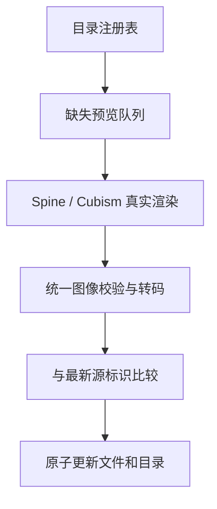

# 项目架构与维护入口

本文描述当前实现；新增和修改代码遵循 [架构规范](ARCHITECTURE_RULES.md)，已知债务与迁移顺序见 [架构评审](ARCHITECTURE_REVIEW_2026-10-23.md)。

站点继续使用 GitHub Pages；无需服务端或前端打包器。页面 URL、模型 ID、收藏与缓存键保持兼容。

## 边界

模块隔离的行为与故障验证见 [2026-10-25 检查](MODULE_ISOLATION_REVIEW_2026-10-25.md)。缓存后端由 `shared/indexeddb-storage.js` 负责，目录 UI 通过兼容委托调用；缓存、语音订阅者和桌面消息接收端的失败不会中断核心播放或释放。共享服务依赖与引擎入口由 `module_boundaries.mjs` 作为补充检查。

- **数据注册**：`data/animation-catalogs.json` 只登记目录；模型来源、引擎、皮肤和预览状态保留在各目录 JSON 中。
- **剧场 UI**：`assets/js/spine/theater-ui.js` 独占工具栏、动作列表、状态提示的 DOM 更新和按钮事件绑定；`viewer-ui-events.js` 把 UI 意图映射为播放器命令。Spine 与 Cubism 通过 UI 接口更新状态；画布、手势和角色交互仍由播放器管理，两侧面板由 `panel-layout.js` 独立管理。
- **浏览器**：`assets/js/shared/catalog-registry.js` 是无 DOM 的显式服务。剧场 bootstrap 读取注册表，目录 UI 由模型数据补充新分组。Spine/Cubism 仍隔离渲染。
- **复合 Spine 立绘**：`shared/spine-companions.js` 只处理显式声明的后层，接收已校验的数据包与播放器，不访问 DOM、不下载、不创建独立帧循环；主播放器拥有纹理及释放。来源、默认待机与所有后层均进入共同来源身份。未声明后层的模型沿用原路径。
- **内容处理**：`catalog_registry.py/mjs` 读取同一注册表；`preview_policy.py` 校验同模型路径/尺寸/摘要；`preview_frame_pipeline.py` 只负责图像处理；`preview_repository.py` 只负责校验、状态转换与文件发布。
- **维护编排**：`maintain_animation_catalog.mjs` 按目录调用既有流水线，拥有并释放本地服务；`preview_capture_state.mjs` 管理逐模型断点与来源/渲染/图像摘要校验。代表模型由来源范围配置声明。见 [日常维护](ANIMATION_MAINTENANCE.md)。
- **CI**：`preview-pipeline.yml` 统一规划待处理 ID、分片采集、转码、校验和发布。游戏命名工作流仅保留手动兼容入口。`deploy-content.yml` 在内容发布成功后显式请求 Pages 构建，核验实际部署提交。
- **桌面**：历史 Electron 在 `desktop/`；Windows 应用在 `native-desktop/`。`web/` 使用 WebView2 CompositionController 复用网页引擎，`rendering/` 保留原生 4.1 与旧导入兼容。Windows YAML 编排步骤，构建实现与验证脚本位于 `native-desktop/build/`。

## 预览数据流



新截图统一 360×420；历史 480×360 截图保留并校验摘要。新增预览只来自对应模型，不允许借用其他角色或皮肤。网络或渲染失败保留在缺失队列，并记录统一错误类型。

发布时使用截图报告中的来源标识与最新目录比较；模型来源更新后，旧帧不得覆盖新记录。所有分片成功完成后才进入发布步骤；模型级失败有报告，不冒充成功。

## Atlas 坐标与实际贴图尺寸

部分源导出包保留原 Atlas 像素坐标，却对 PNG 做过缩放。源适配器通过模型数据 `atlasCoordinateSpace: "declared"` 明确启用 `assets/js/shared/spine-atlas-coordinates.js`，按每页声明尺寸换算 Region 和 Mesh 的 UV；GPU 图像和原始素材不被修改。未启用的模型保留原生坐标语义，不能仅凭尺寸不同推断来源一定经过缩放。

该策略属于资源解释契约，进入浏览器、Node 与 Python 共用的来源标识；改变策略后旧预览失效并由共同流水线重新采集。已有下载包仍可使用，在播放时应用新适配。覆盖四种旋转、裁切偏移、不同轴缩放、非活动皮肤、关联网格、重复更新和一像素边缘扩展。

## 取景与渲染会话

`shared/portrait-framing.js` 通过显式像素/矩形输入计算可见内容和相机范围，Spine/Cubism 各自处理绘制回调和坐标转换。一个模型会话拥有稳定取景；动作切换保留用户缩放和平移。旧版 Spine 的停止/释放由运行时适配负责，Live2D 模拟和绘制共用 Application ticker。具体行为与验收见 [取景与生命周期](PORTRAIT_VIEW_LIFECYCLE.md)。

## Live2D 动作与来源覆盖

`shared/cubism-motion-policy.js` 统一枚举命名/匿名动作组、待机选择、源循环标志、优先级、有限等待及会话取消。引擎适配传入 MotionManager 与当前会话判定；共享策略不访问 DOM，不按游戏 ID 分支。视口先读取有效网格的实际范围，避免把 MOC 画布尺寸误当裁切框。网页明确绘制剧场底色，桌面保持透明黑色清屏。

`data/live2d-source-scopes.json` 声明固定来源范围；`scripts/live2d_sources.mjs` 共同执行来源覆盖、文件引用校验和受控导入。已有模型 ID、素材地址和有效预览保持兼容。见 [本轮共性修复与覆盖记录](LIVE2D_COMMON_REPAIR.md)。

旧版 JSONC 配置通过纯函数 `cubism_source_settings.mjs` 标准化为 `assets/model-settings/` 中的本地设置。所有骨骼、贴图和动作仍指向同一固定上游版本；文件名大小写与导出子目录修正必须由来源配置声明、唯一匹配并保留修正记录。只从当前模型目录补入遗漏动作，不借用其他角色。设置 URL 绑定内容 SHA256，内容变化使旧预览身份失效。浏览器目录验证与具体来源适配共同约束本地设置路径、模型 ID 和摘要。

`dynamic_encyclopedia_coverage.mjs` 读取基础全目录盘点及 `data/*-full-inventory.json` 的更新盘点；相同固定来源目录以更新盘点替换旧盘点，避免多个导入适配重复计数。来源全集覆盖与游戏当前版本的角色、皮肤全集完整性分别报告。

## 内容上线

预览、静态扩充以及手动兼容流程成功后，通过 `workflow_run` 触发共同的站点发布。机器人 push 本身不会触发 Pages 分支构建，因此不能省略这条依赖。

`request_pages_build.cjs` 使用现有 main 根目录 Pages 配置，请求构建并等待包含目标提交的实际成功结果。旧构建、失败或超时都不能视为上线。切换 Pages Source 时，应同时迁移这份契约与回归测试。

## 新增游戏

1. 选择已有 Spine/Cubism 资源适配；准备有来源与版本标识的目录 JSON。
2. 在注册表添加目录条目。共享加载器和队列自动读取，分组可从记录的 `collectionName/game` 取得。
3. 新来源若超出 Cubism 白名单，在源适配器添加经审核的来源规则及拒绝越界 URL 的测试；不能放开任意地址来绕过验证。
4. 运行 `npm test`、`npm run check`、`npm run test:python`。
5. 通过统一预览工作流生成真实截图，并通过实际浏览器播放回归。不要复制一份游戏专属截图或发布流程。

## 开发命令

```sh
python -m pip install -r requirements-dev.txt
python start_site.py
npm test
npm run check
npm run test:python
npm run maintain:animation -- --catalog games-wave6
python scripts/preview_pipeline.py plan
python scripts/preview_pipeline.py convert
python scripts/preview_pipeline.py publish
```

采集命令为 `node scripts/repair_missing_previews.mjs SHARD COUNT`，需要固定版本的 playwright-core、pngjs 和 Chromium。普通单元测试不依赖浏览器或外网。

固定树的 Cubism 来源复用共同维护入口：来源适配器声明冻结树、名称映射和经核验的设置修正，设置文件按 Git blob 摘要缓存；代表模型由 `test_cubism_source_browser.mjs` 验证原生播放及待机。辅助特效与视觉质量缺项分别审计，后者始终保留为未解决的源覆盖缺口。本地采集和相关浏览器回归共享单路默认及硬件渲染核验，不再强制 CPU 软件渲染。

## 分阶段迁移

经典脚本的共享全局环境仍是明确的兼容边界。后续按“存储、播放会话、语音、视图”逐个迁移至显式接口，再切换入口为 ES Modules；不能同时重写所有渲染器和存储，以免丢失用户收藏或已下载资源。

完整问题清单和未完成债务见 [本次架构评审](ARCHITECTURE_REVIEW_2026-10-23.md)。根目录 AGENTS 和 `tests/check_architecture.mjs` 是持续约束，不能只改文档不运行检查。

## 原生渲染维护边界

Windows 原生 Spine 4.1 宿主的持续维护模块位于 `native-desktop/rendering/`。输入快照、三角形覆盖与表面容量检查为纯 C# 服务；四个上游渲染/输入模块通过固定摘要清单安装。构建适配先核对全部原始输入，拒绝源变化或新类型冲突，成功后记录实际安装源摘要。剩余兼容钩子仍有唯一锚点检查，不能宣称全部原生适配均已去除补丁。完整重建输入包含在 GPL 源码产物中。性能数据、回归与兼容范围见 [桌宠优化记录](DESKTOP_OPTIMIZATION.md)。

## 通用桌面宿主

网站传递游戏与角色 ID，客户端只导航固定站点；共同注册表继续拥有资源与引擎选择。`native-desktop/web/` 拥有控制器、GPU 合成 visual、输入窗口、取消与持久配置。网页 `desktop-webview-bridge.js` 在完整绘制后报告就绪和有预算的 Alpha 命中区域，复用已有动作/缩放命令；掩模不参与显示。旧 NIKKE/BD2 原生链接与文件目录保留。升级、运行时与实际验证范围见 [通用桌面架构](UNIVERSAL_DESKTOP.md)。


### 多角色与点击交互

桌面角色集合按游戏和模型 ID 拥有独立宿主、取消和可见状态；隐藏、移除、加载失败不得影响其他角色。
操作系统点击仅由输入窗口接收，菜单与视觉合成分离。共用的 `shared/portrait-interactions.js` 是无 DOM 的源区域/动作解析策略；Spine 与 Cubism 适配器负责坐标转换和手势。
交互能力区分源点击区域、具备源触摸动作但仅能估算分区、以及没有互动动作，不能把待机/攻击动画冒充点击互动。

## 动态目录增量兼容

导入器共同合并稳定 ID，保留无关游戏、已有来源及有效预览；资源替换须逐 ID 声明。常规 CI 通过 `catalog_compatibility.mjs` 对实际变更基线检查旧链接、角色/皮肤、源身份和预览文件摘要。约束见 [架构规范第 13 节](ARCHITECTURE_RULES.md#13-动态目录增量兼容)，本轮检查与实际验证范围见 [兼容检查记录](CATALOG_COMPATIBILITY_REVIEW_2026-10-25.md)。
